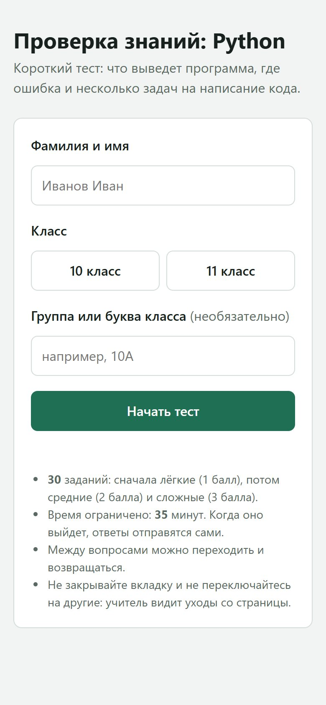

<div align="center">

# Тест по программированию для класса

**Учитель запускает сервер на ноутбуке, ученики проходят тест с телефонов. Без интернета.**

  

</div>

<table>
<tr>
<td align="center" valign="top"></td>
</tr>
</table>

<!-- header:end -->
Локальный сервер для контрольной по Python: учитель запускает его на ноутбуке, ученики открывают ссылку с телефонов или ПК в той же сети. Интернет не нужен, зависимостей нет, только стандартная библиотека Python.

## Возможности

- 30 вопросов трёх уровней сложности (`questions.py`), порядок перемешивается для каждого ученика;
- таймер, автосдача по окончании времени;
- учёт ухода со вкладки (антисписывание);
- панель учителя `/admin?key=…`, ключ печатается в консоли при старте;
- результаты в `results/results.csv` (открывается в Excel) и JSON;
- `grade_manual.py` и `make_excel.py` сводят бумажные работы и результаты из дашборда в одну таблицу Excel.

## Запуск

```bash
python server.py                 # 30 минут, порт 8000
python server.py --minutes 25 --port 8080
python server.py --ip            # показать IP-адреса ноутбука
```

На Windows можно просто запустить `ЗАПУСК.bat`. Ученики открывают `http://<IP-ноутбука>:8000`.

> Результаты учеников (`results/`) в репозиторий не попадают.
